# Earthset · Base no polo sul da Lua


Jogo de gestão em 3D, no navegador, para o **NASA Space Apps Challenge 2026** (desafio *Junior Astronaut Mission Trainer*). O jogador administra uma base no polo sul da Lua durante um **dia lunar de 708 horas**. Vence chegando à hora 708 com pelo menos 1 coração. Perde quando os 3 corações acabam.

> *One mission. One base. 708 hours to survive.*

- **Autor:** Christian Mendes (`dev-christianmendes`), projeto solo.
- **Início do projeto:** 14/11/2026. **Prazo de envio:** 15/11/2026, 23h59 (horário local).
- **Idiomas:** inglês (padrão) e português do Brasil, com botão na interface.
- **Uso de IA:** declarado em [`AI_DISCLOSURE.md`](AI_DISCLOSURE.md) (Claude Code e Codex).
- **Licença:** MIT, ver [`LICENSE`](LICENSE).

Status atual, pendências e inventário completo: [`docs/ESTADO_PROJETO_2026-11-15.pdf`](docs/ESTADO_PROJETO_2026-11-15.pdf).

---

## Sumário

1. [Telas iniciais](#1-telas-iniciais)
2. [Introdução e história](#2-introdução-e-história)
3. [A base](#3-a-base)
4. [Controles e seleção](#4-controles-e-seleção)
5. [Painéis de cada objeto](#5-painéis-de-cada-objeto)
6. [Recursos e regras](#6-recursos-e-regras)
7. [Alertas de radiação e clima espacial](#7-alertas-de-radiação-e-clima-espacial)
8. [LUMA, o guia da base](#8-luma-o-guia-da-base)
9. [Modos de experiência e modo escola](#9-modos-de-experiência-e-modo-escola)
10. [Fim de partida](#10-fim-de-partida)
11. [Ciência e dados reais](#11-ciência-e-dados-reais)
12. [Como rodar e verificar](#12-como-rodar-e-verificar)
13. [Estrutura do código](#13-estrutura-do-código)
14. [Limitações conhecidas](#14-limitações-conhecidas)

---

## 1. Telas iniciais

| | |
|---|---|
| 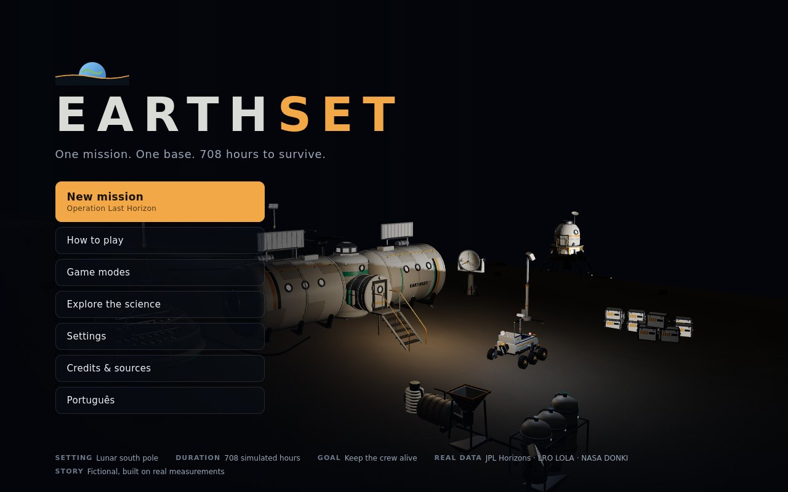 | **Menu.** Nova missão, Como jogar, Modos de jogo, Explore the science, Configurações, Créditos e idioma. |
|  | **Modos de jogo.** Explorer, Lunar Cadet e Commander, com o mesmo núcleo científico. Ver [seção 9](#9-modos-de-experiência-e-modo-escola). |
|  | **Como jogar.** Resumo das regras: tempo, recursos, missões, ciência, clima espacial e controles. |
|  | **Explore the science.** Explica o Sol no polo, o horizonte medido pelo LOLA, o gelo, o clima espacial e o que é ilustrativo. |
|  | **Configurações.** Intro antes de cada missão, movimento reduzido, explicações ao lado dos recursos, sombras de alta qualidade e idioma. |
| 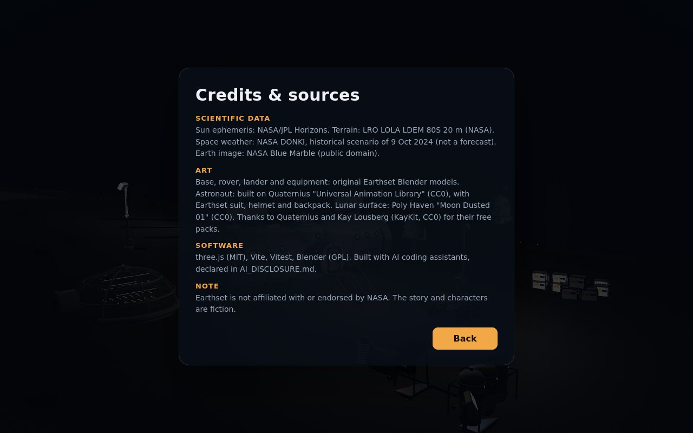 | **Créditos e fontes.** Dados científicos, ativos de arte e software, com a nota de que a história é ficcional. |
| 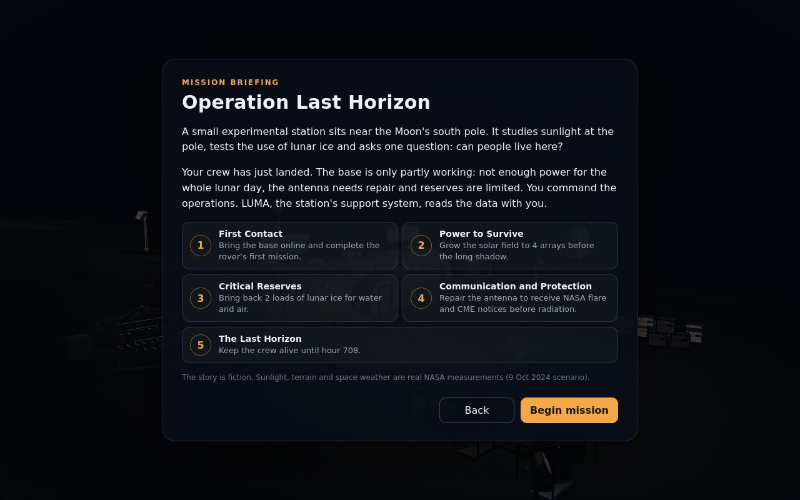 | **Briefing da missão** "Operation Last Horizon", com os cinco capítulos. |

No celular, o menu se adapta à tela:

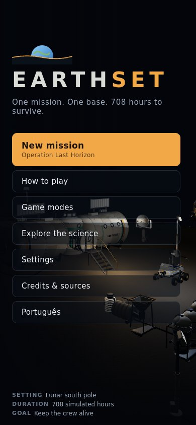

## 2. Introdução e história

A missão começa com uma introdução animada de cerca de 16 segundos: pouso do módulo, base, astronauta e a LUMA. Pode ser pulada com **Esc** ou pelo botão *Skip intro*. A opção *Play the intro before each new mission* a desliga, e o movimento reduzido remove os voos de câmera.

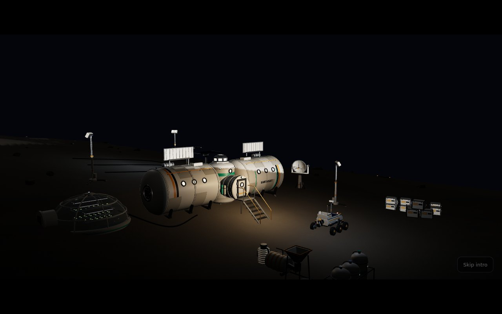

A história tem cinco capítulos, derivados do estado real da base (não de um roteiro fixo):

1. **First Contact:** a base online e a primeira missão do rover concluída.
2. **Power to Survive:** quatro painéis solares instalados.
3. **Critical Reserves:** duas viagens de gelo concluídas.
4. **Communication and Protection:** antena instalada.
5. **The Last Horizon:** chegar à hora 708.

O enredo é ficcional. Fatos da missão não são apresentados como medição da NASA.

## 3. A base

A base é composta por áreas: habitação, energia, ciência, logística, comunicação e pouso. Está apoiada no relevo medido do morro LOLA, com cabos, trilhas e luzes operacionais.

| | |
|---|---|
|  | **Dia.** O Sol aparece no céu conforme a efeméride JPL Horizons. A barra superior mostra hora, fase, recursos, corações e velocidade. |
| 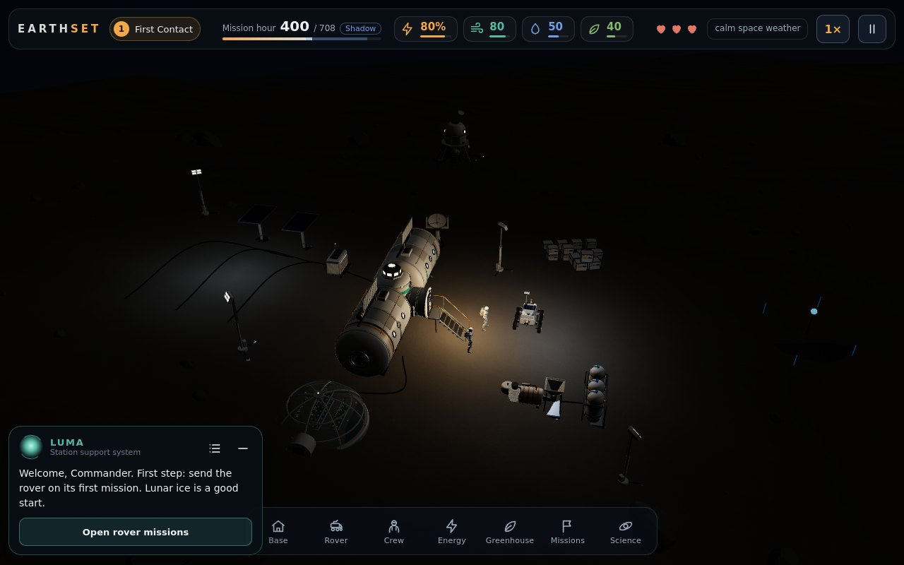 | **Noite.** Sem Sol, os painéis param e a base depende da bateria. As sombras são duras, como na Lua. |
| 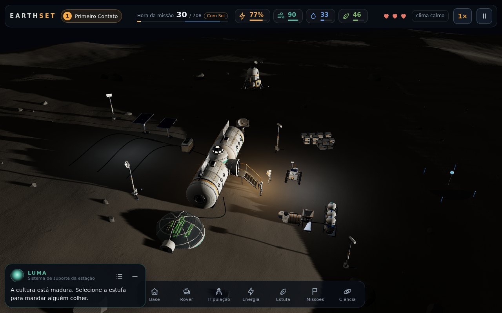 | **Português.** Toda a interface, inclusive a LUMA, tem versão em português do Brasil. |

No celular (390 × 844), a base se adapta à tela e não tem rolagem horizontal, o que o teste de celular verifica:

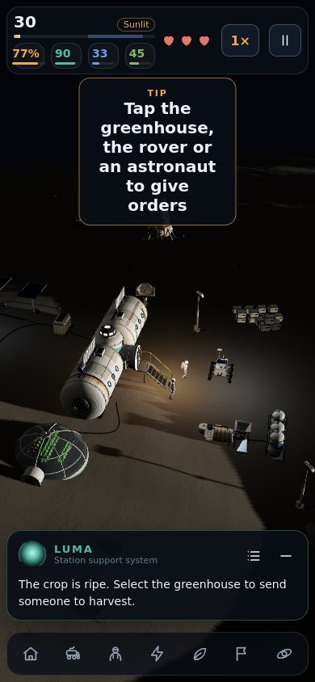

Barra superior: nome da base, capítulo atual, tempo de missão (hora / 708), fase do Sol (*Sunlit* ou *Night*), bateria, ar, água, comida, corações, clima espacial e velocidade (1×, 2×, 4×) com pausa.

Barra inferior: atalhos para Base, Rover, Crew, Energy, Greenhouse, Missions e Science.

## 4. Controles e seleção

- **Tocar ou clicar** num objeto da base abre o painel contextual dele. Rover, estufa, habitat, painéis, antena, processador, armazenamento e cada astronauta são selecionáveis.
- **Teclas 1 a 9:** habitat, estufa, rover, astronauta 1, astronauta 2, painéis, antena, processador e armazenamento.
- **Arrastar** gira a câmera; a **roda** (ou a pinça no celular) aproxima e afasta. Arrastar não seleciona.
- **Setas** giram e inclinam a câmera, **+** e **−** aproximam e afastam, **O** volta à visão geral e **C** solta a câmera (também pelo botão de câmera no topo).
- **Esc** fecha o painel; sem painel aberto, pausa o jogo.
- **Tab** e **Enter** navegam pelos botões do painel.
- **Pausa** pelo botão ou pela tecla Esc.

Exemplo, com a seleção de cada objeto:

| | |
|---|---|
| 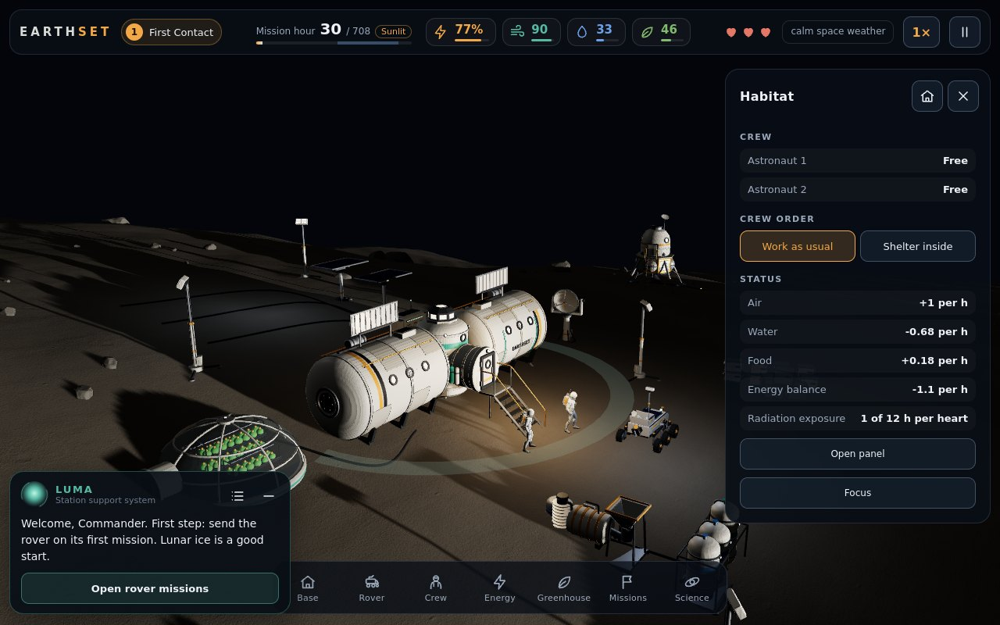 | **Habitat.** Astronautas livres, ordens de abrigo, consumo e exposição à radiação. |
| 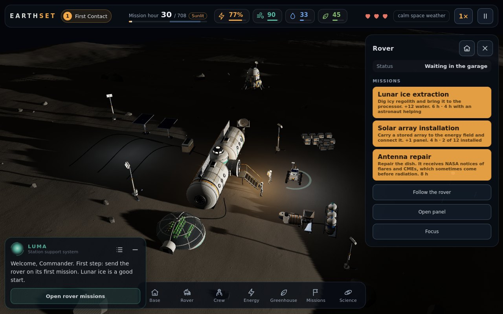 | **Rover.** Lista de missões com custo, duração e motivo de recusa, quando houver. |
| 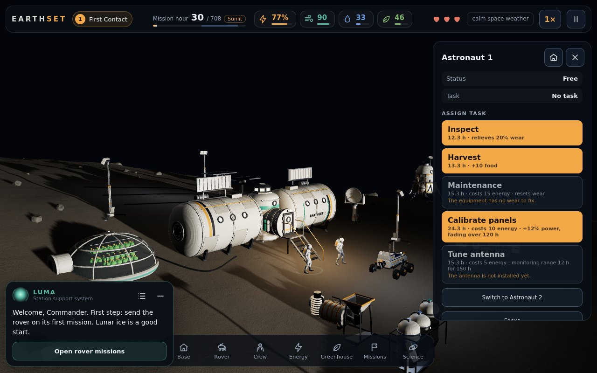 | **Astronauta.** Estado, tarefa atual e tarefas disponíveis (inspecionar, colher, manutenção, calibrar, ajustar antena). |

Pausa e menu da pausa:

| | |
|---|---|
|  | **Pausa.** Retomar, Como jogar, Configurações ou menu principal. |

## 5. Painéis de cada objeto

Cada painel mostra o estado do objeto e só oferece ações válidas. Quando uma ação não está disponível, o motivo aparece no próprio botão, vindo do motor.

### 5.1 Rover (missões de gelo, painéis e antena)

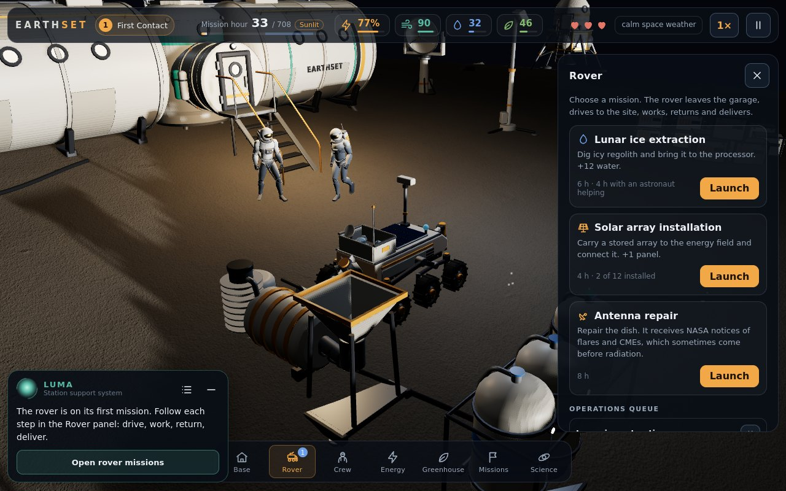

- Fila de até **4 missões**: *Lunar ice extraction* (gelo), *Solar array installation* (painel) e *Antenna repair* (antena).
- Cada missão passa por etapas: preparo, ida, escavação ou instalação, volta e entrega.
- O gelo entregue vira **+12 de água**. Cada painel instalado soma **+1 painel** (até 12).
- A antena, uma vez instalada, habilita o aviso de radiação (ver [seção 7](#7-alertas-de-radiação-e-clima-espacial)).
- Radiação ou bateria zerada suspendem a missão e o painel mostra o motivo.
- O botão *Follow the rover* faz a câmera acompanhar o rover durante a viagem.


### 5.2 Estufa


- **Cultivo:** a cultura cresce de 0 a 100 em cerca de 12 horas com cuidado normal. Estágios: muda, planta desenvolvida e pronta para colheita.
- **Irrigação** (baixa, normal, alta): troca água por ritmo de crescimento.
- **Iluminação** (baixa, normal, alta): troca energia por ritmo de crescimento.
- **Desgaste:** sobe com o tempo e reduz a eficiência. Inspeção alivia; manutenção zera.
- **Modo da estufa:** *Off*, *Only with surplus* (liga com bateria acima de 50%) ou *Always on* (liga com bateria acima de 10%).
- **Colheita:** um astronauta colhe a cultura pronta e entrega **+10 de comida**.

### 5.3 Tripulação


- **Dois astronautas.** Cada um tem estado (*Free*, *Outside*, *In the shelter*), tarefa e descanso.
- **Ordem da tripulação:** *Auto* (cuidam da estufa e ajudam o rover no gelo) ou *Shelter* (ficam no habitat).
- **Tarefas:** inspecionar a estufa, colher, manutenção da estufa, calibrar painéis e ajustar a antena. Uma tarefa de cada tipo por vez.
- **Exposição:** quem está fora do habitat durante radiação conta como exposto. A tarefa é suspensa e retomada depois.
- *Focus camera on the astronaut* leva a câmera ao astronauta.

Tarefas no painel de astronauta:


### 5.4 Energia (painéis solares)


- **Bateria** com capacidade de 1000 unidades e fluxo líquido por hora.
- **Painéis:** instalados e em uso; cada um gera energia só com Sol.
- **Luz do dia:** mostra o estado do Sol e quando começa a noite longa (*Long night starts in X h*).
- **Calibrar painéis:** aumenta a geração em até 12%, por tempo limitado.

### 5.5 Antena

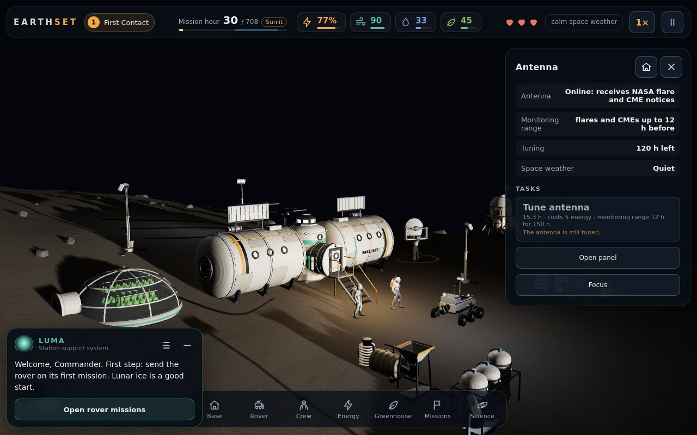

- A antena recebe avisos NASA DONKI de erupções e CMEs, com alcance de cerca de 6 horas, ou 12 horas depois de ajustada.
- **Ajustar antena** dura 150 horas de jogo e aumenta o aviso para 12 horas.
- Sem antena instalada, a base só percebe a tempestade quando ela já começou.

### 5.6 Habitat


- Estado de pressurização, ar, água, comida, consumo e exposição à radiação.
- Ordem de abrigo para os astronautas.

### 5.7 Processador de gelo e armazenamento

- **Processador:** transforma o gelo em água. Estado e missão de gelo aparecem no painel.
- **Armazenamento:** estoques de cada recurso e autonomia estimada.

### 5.8 Missões

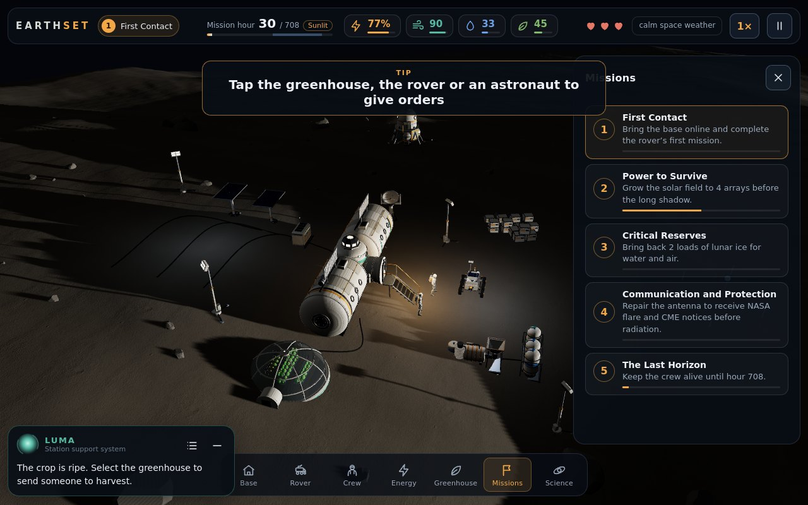

Lista de capítulos e missões, com progresso de cada uma.

## 6. Recursos e regras

Quatro recursos vão de 0 a 100 (bateria vai de 0 até a capacidade):

| Recurso | Como sobe | Como cai |
|---|---|---|
| **Energia** | painéis com Sol (0,9 por painel por hora) | base (0,8), aquecimento, estufa, eletrólise, tarefas |
| **Ar** | eletrólise (+2 por hora) | consumo da tripulação (−1 por hora, ajustado pela patente) |
| **Água** | gelo processado (+12 por viagem), eletrólise | consumo e estufa |
| **Comida** | colheita (+10) e estufa ligada (+0,38 por hora) | consumo da tripulação |

- **Equipamentos automáticos:** estufa e eletrólise ligam e desligam sozinhos conforme a bateria e o ar. O **modo economia** (bateria abaixo de 40%) desliga a estufa.
- **Corações:** a base começa com 3. Cada 6 horas seguidas com energia, ar, água ou comida zerados tira 1 coração. Sem bateria, a base esfria e perde corações.
- **Patentes:** Lunar Cadet, Explorer e Commander mudam o consumo da tripulação (×0,75, ×1 e ×1,15).
- **Vitória:** chegar à hora 708 com pelo menos 1 coração.
- **Derrota:** os três corações acabam.

Os números completos e os que são ajustáveis estão em [`docs/regras-recursos.md`](docs/regras-recursos.md).

## 7. Alertas de radiação e clima espacial

Os eventos de radiação vêm do catálogo histórico da NASA DONKI (partículas solares e tempestades geomagnéticas, em 9 de outubro de 2024). Para cada evento, a base passa por estados:

**NORMAL → MONITORAMENTO → ALERTA → ABRIGO → RECUPERAÇÃO**


Na tela de alerta, a LUMA diz o que fazer e o botão *Open crew orders* leva à ordem de abrigo. O painel Science mostra o histórico e a proveniência de cada evento.

Durante o abrigo, astronautas e rover voltam ao habitat. Tarefas são suspensas e recomeçam depois.

## 8. LUMA, o guia da base

A LUMA é o sistema de apoio da base. Ela dá dicas, comenta eventos e avisa de alertas. Funciona por **regras**, sem IA generativa em tempo de jogo.

| | |
|---|---|
|  | **Histórico.** Botão de histórico lista os avisos recentes. Minimizar recolhe a LUMA no canto. |

A LUMA também abre atalhos: *Open rover missions*, *Open crew orders*, e outros conforme a situação.

## 9. Modos de experiência e modo escola

Três modos com o mesmo núcleo científico. Só mudam o apoio ao jogador e o consumo da tripulação:

| Modo | Para quem | Diferença |
|---|---|---|
| **Explorer** | iniciantes | LUMA guia cada passo, linguagem simples, explicações visuais, tripulação consome 25% menos |
| **Lunar Cadet** | jogo casual | gestão completa de recursos, alertas contextuais, equilíbrio de referência |
| **Commander** | experientes | HUD técnico com fluxos por hora, LUMA só com alertas críticos, tripulação consome 15% mais |

**Modo escola.** Nas configurações, *Show explanations next to resources* ativa uma explicação curta ao lado de cada recurso. O painel de energia e o da base mostram o que cada item faz, por que muda e de onde vem o dado.


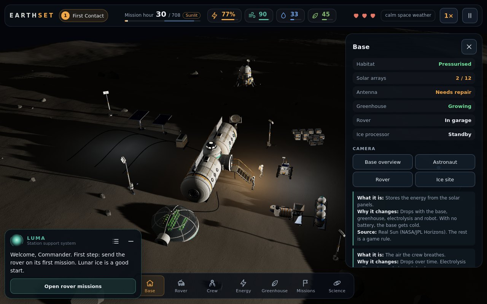

## 10. Fim de partida

A partida termina em vitória (chegar à hora 708 com pelo menos 1 coração) ou em derrota (os três corações acabam). A tela de fim mostra o resumo: modo, hora alcançada, corações restantes, cargas de gelo entregues, painéis instalados e capítulos concluídos, com os botões *Play again* e *Main menu*.


A captura acima é uma derrota: a base foi perdida na hora 117, por falta de recursos, porque a partida foi avançada até a hora 708 sem nenhuma ação. A tela de vitória ainda não tem captura automática.

## 11. Ciência e dados reais

| Dado | Fonte | Uso no jogo |
|---|---|---|
| Posição do Sol no polo sul | NASA JPL Horizons | energia, luz e disco solar |
| Relevo e horizonte do morro | NASA LRO LOLA | pouso da base e horizonte local |
| Eventos de radiação | NASA DONKI | alertas e abrigo |
| Céu: 7 corpos e 904 estrelas | JPL Horizons, catálogo BSC5 (NOIRLab) | modo Ciência |
| Textura da Terra | NASA Blue Marble (domínio público) | Terra na cena |

Dados processados offline pelos pipelines em `data-pipeline/`. O jogo lê arquivos gerados e não consulta a NASA durante a partida. Fontes, método e limites em [`docs/data-sources.md`](docs/data-sources.md). O que é ilustrativo (taxas de consumo, horizonte local por sítio e outros números de jogo) está marcado no código e na tela.

**Painel Science:**

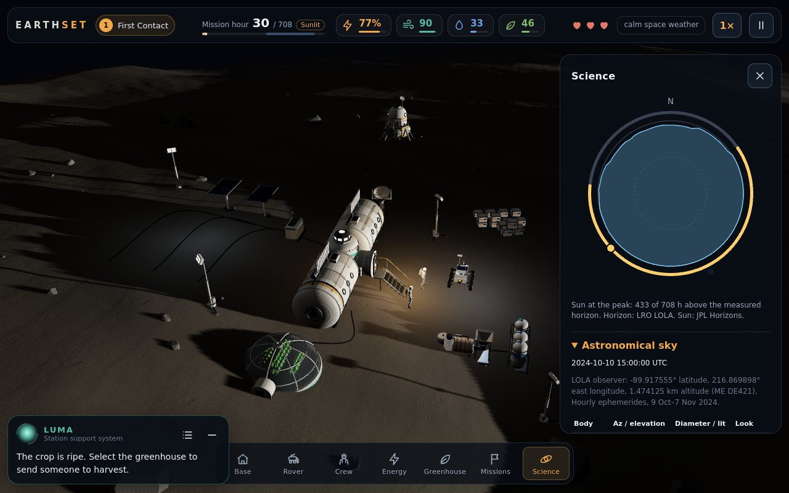

**Explore the science (menu):**


## 12. Como rodar e verificar

Pré-requisito: **Node 24** e npm com `package-lock.json`.

```bash
npm install
npm run dev         # servidor de desenvolvimento
npm run typecheck   # tsc --noEmit, modo strict
npm run test        # Vitest: motor, partidas completas, astronomia, i18n e modo escola
npm run build       # typecheck + build estático em dist/
```

Pipeline de dados e testes Python:

```bash
PYTHONDONTWRITEBYTECODE=1 python3 -B -m unittest discover -s data-pipeline/tests
```

Testes de interface (Playwright em Python, contra o servidor de desenvolvimento):

```bash
npx vite --port 5182 --strictPort &
python3 scripts/e2e-contexto.py 5182      # painel contextual, ordens, rover e teclado
python3 scripts/e2e-tempestade.py 5182    # cenário de radiação, abrigo e recuperação
python3 scripts/e2e-astronomy.py 5182     # Sol, Terra, céu e modo Ciência
python3 scripts/e2e-descoberta.py 5182 saida.png   # caminho do jogador pelo menu (exige GPU)
```

Capturas desta página:

```bash
python3 scripts/capturas-readme.py 5190 docs/img
```

### Resultado da última verificação (15/11/2026)

| Verificação | Resultado |
|---|---|
| `npm run typecheck` | sem erros |
| `npm run test` (Vitest) | 208 testes em 23 arquivos, todos passando |
| `scripts/e2e-contexto.py` | 38 verificações, nenhuma falha |
| `scripts/e2e-tempestade.py` | 37 verificações, nenhuma falha |
| `scripts/e2e-astronomy.py` | 32 verificações, nenhuma falha |
| `scripts/e2e-descoberta.py` | 20 verificações; uma execução com 1 falha (*aba Missions segue como painel lateral*) e outra sem falhas. Instável, investigação pendente |
| `scripts/capturas-readme.py` | 29 capturas geradas sem erro de página |

Os testes de interface rodaram em renderização por software (SwiftShader). Por isso, o desempenho medido por `e2e-astronomy.py` nesse ambiente não representa uma GPU real. As medições de desempenho em GPU estão em [`docs/execution-log.md`](docs/execution-log.md).

## 13. Estrutura do código

| Pasta | Conteúdo |
|---|---|
| `src/engine/` | Regras do jogo em TypeScript puro: tempo, recursos, robô, astronautas, estufa, instalações, alertas, modos, capítulos e LUMA |
| `src/render/` | Cena Three.js: base, luz, sombras, céu, câmera, introdução e seleção por toque |
| `src/astronomy/` | Modelo do céu: corpos, estrelas e horizonte |
| `src/ui/` | HUD, painéis, telas, menus e LUMA |
| `src/data/` | Dados gerados pelos pipelines, lidos pelo motor |
| `data-pipeline/` | Pipelines Python offline e seus testes |
| `tests/` | Testes Vitest do motor, astronomia, i18n e modo escola |
| `scripts/` | Testes e capturas de interface com Playwright |
| `assets-src/` | Fontes Blender e pacotes de terceiros, com licença |
| `public/` | Modelos GLB e texturas servidos ao navegador |
| `docs/` | Documentação e capturas (`docs/img/`) |

**Regra de fronteira:** `src/engine/` não importa three.js e não usa DOM nem `window`. O CI verifica isso no job `boundary`.

Índice da documentação: [`AGENTS.md`](AGENTS.md) (ponto de entrada), [`docs/PLANO_V4.md`](docs/PLANO_V4.md) (plano vigente), [`docs/backlog.md`](docs/backlog.md), [`docs/INTERACOES.md`](docs/INTERACOES.md), [`docs/regras-recursos.md`](docs/regras-recursos.md), [`docs/data-sources.md`](docs/data-sources.md), [`docs/event-rules.md`](docs/event-rules.md), [`docs/execution-log.md`](docs/execution-log.md).

## 14. Limitações conhecidas

- A tela de vitória ainda não tem captura automática.
- O rover segue rota fixa e não desvia de obstáculos.
- A calibração dos painéis vale para o campo solar inteiro, sem escolher um painel.
- A base passiva perde por volta da hora 117 sem ações do jogador.
- `scripts/e2e-descoberta.py` está instável: o teste da aba *Missions* falhou em uma de duas execuções.
- O tamanho do JS de produção passa de 500 kB (three.js inteiro) e há carregamento inicial com tarefas longas; ainda sem divisão de pacote.
- O mapeamento de astrometria estelar e a validação do ponto de observação contra o morro LOLA ainda estão em aberto (DT-16 e AST-P1).

Lista completa de pendências: [`docs/ESTADO_PROJETO_2026-11-15.pdf`](docs/ESTADO_PROJETO_2026-11-15.pdf).

## Uso de IA

Desenvolvido com auxílio de Claude Code e Codex. Modelos e ferramentas em [`AI_DISCLOSURE.md`](AI_DISCLOSURE.md). Nenhum conteúdo gerado por IA é usado como ativo do jogo. A LUMA funciona por regras.

## Marcas e direitos

O projeto não usa logotipo, insígnia, bandeira ou patch da NASA. Dados da NASA e do JPL são usados com as fontes de [`docs/data-sources.md`](docs/data-sources.md). Ativos de terceiros estão em `assets-src/` com a licença de cada um.

## Licença

MIT, ver [`LICENSE`](LICENSE).
