# Earthset · A Base at the Lunar South Pole

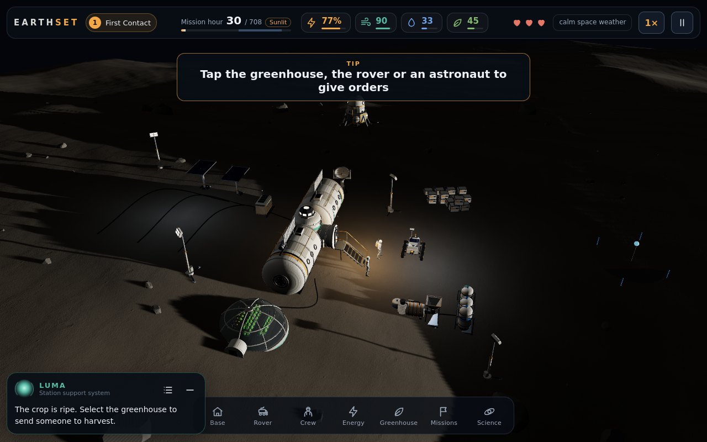

**Earthset** is a browser-based 3D base-management game built for the **NASA Space Apps Challenge 2026**, challenge *Junior Astronaut Mission Trainer*. You run a small base on the lunar south pole through one lunar day: **708 hours**. Keep the crew alive, keep the power on, and reach hour 708 with at least one heart left.

- **Play:** https://earthset-nasa-challenge.vercel.app (or run it locally, [section 5](#5-run-it-locally))
- **Author:** Christian Mendes (`dev-christianmendes`), solo project
- **Languages:** English (default) and Brazilian Portuguese, switchable in the interface
- **License:** MIT, see [`LICENSE`](LICENSE)
- **AI use:** declared in [`AI_DISCLOSURE.md`](AI_DISCLOSURE.md)

---

## Contents

1. [The mission](#1-the-mission)
2. [Screens](#2-screens)
3. [The base and its systems](#3-the-base-and-its-systems)
4. [Controls](#4-controls)
5. [Run it locally](#5-run-it-locally)
6. [Deploy](#6-deploy)
7. [Science behind the game](#7-science-behind-the-game)
8. [Illustrative vs. measured](#8-illustrative-vs-measured)
9. [Project structure](#9-project-structure)
10. [Tests and verification](#10-tests-and-verification)
11. [Known limitations](#11-known-limitations)
12. [Credits and references](#12-credits-and-references)

---

## 1. The mission

The base sits on a plateau near the lunar south pole. The sun stays low over the horizon, and terrain blocks it for long stretches, so solar power comes and goes. Solar storms bring radiation that sends the crew into shelter. Water, air and food run down while you work.

The match is one lunar day of **708 game hours**.

- **You win** by reaching hour 708 with at least one heart.
- **You lose** when all three hearts are gone. A heart is lost after six consecutive hours with a vital resource at zero.

The story is told in five chapters that follow the real state of the base, not a fixed script:

| # | Chapter | Done when |
|---|---|---|
| 1 | First contact | The rover completes its first mission |
| 2 | Power up | Solar panels are installed |
| 3 | Ice run | Enough ice trips are delivered |
| 4 | Signal | The antenna is installed |
| 5 | One lunar day | The base reaches hour 708 with a living crew |


## 2. Screens

**Menu and modes.** Start a new mission, read how to play, explore the science, or change settings. Three modes share the same rules and science; they differ in how much help the guide gives.

| | |
|---|---|
|  | 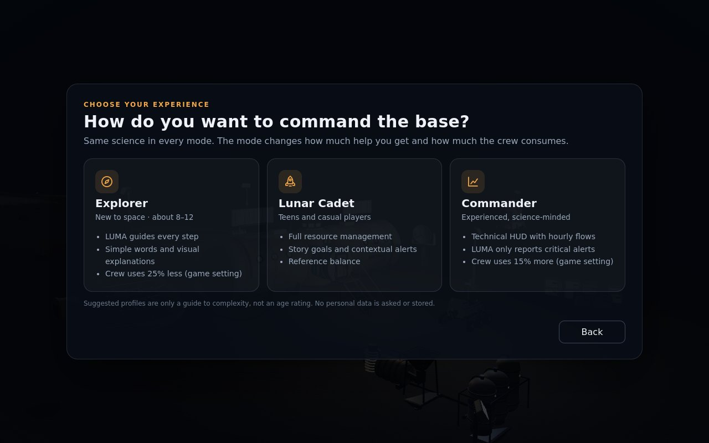 |
| The main menu: new mission, how to play, modes, science, settings, credits and language. | Mode selection: Explorer, Lunar Cadet and Commander. |

**Learning the game.** A short "how to play" screen summarises time, resources, missions, science, space weather and controls. The science screen explains the sun at the pole, the horizon measured by LOLA, the ice and the space weather.

| | |
|---|---|
| 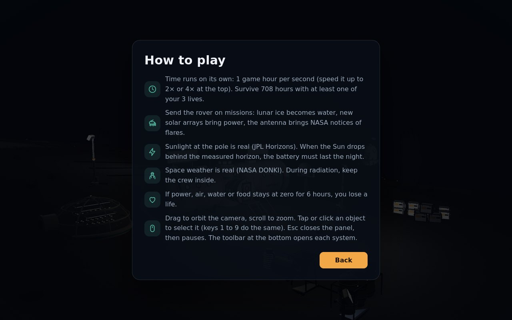 | 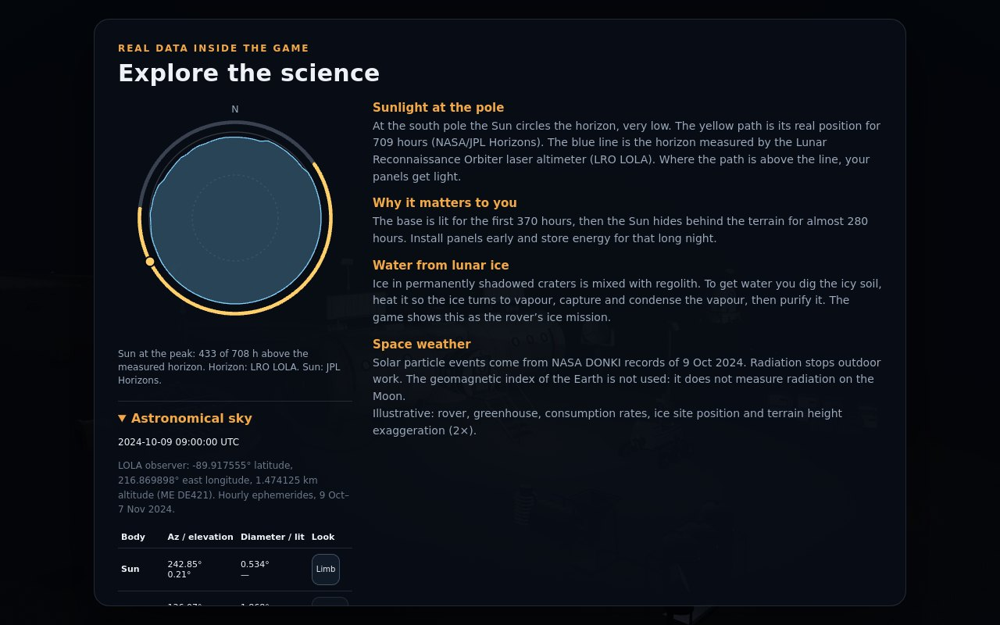 |
| How to play: the rules in one screen. | Explore the science: what is measured and what is illustrative. |

**Settings and credits.** Intro before each mission, reduced motion, explanations next to each resource, shadow quality and language. The credits list every data source, art asset and software library.

| | |
|---|---|
| 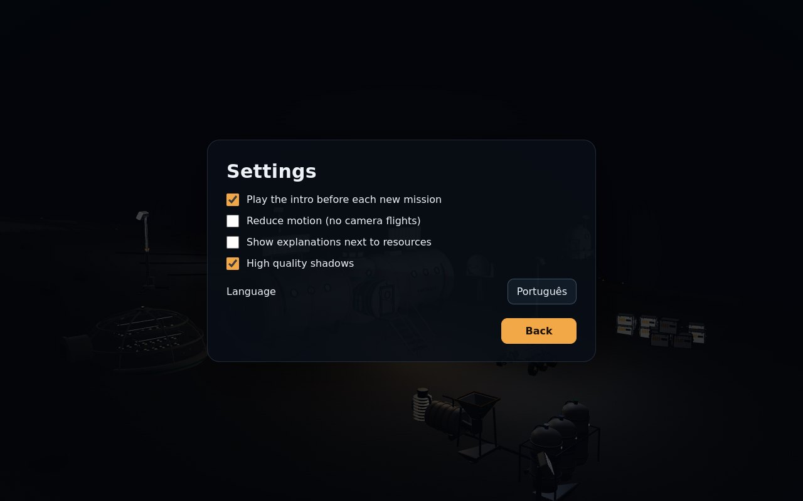 |  |
| Settings. | Credits and sources. |

**Mission briefing and intro.** Each match opens with a short animated intro, then the briefing for the five chapters.

| | |
|---|---|
|  |  |
| Briefing, with the five chapters. | Intro: the lander, the base, an astronaut and LUMA. |

**In the base.** The base is a 3D scene with a daylight and a night view. The top bar shows time, mission hour, power, air, water, food, lives and the speed control. The bottom bar switches between the views of the base, rover, crew, energy, greenhouse, missions and science.

| | |
|---|---|
|  |  |
| The base in daylight. | The base at night, with the lights on. |


Panels open when you select an object in the scene or a tool from the bottom bar. Each one shows the state, the actions you can take, what they cost, and why an action is not available right now.

| | |
|---|---|
|  | 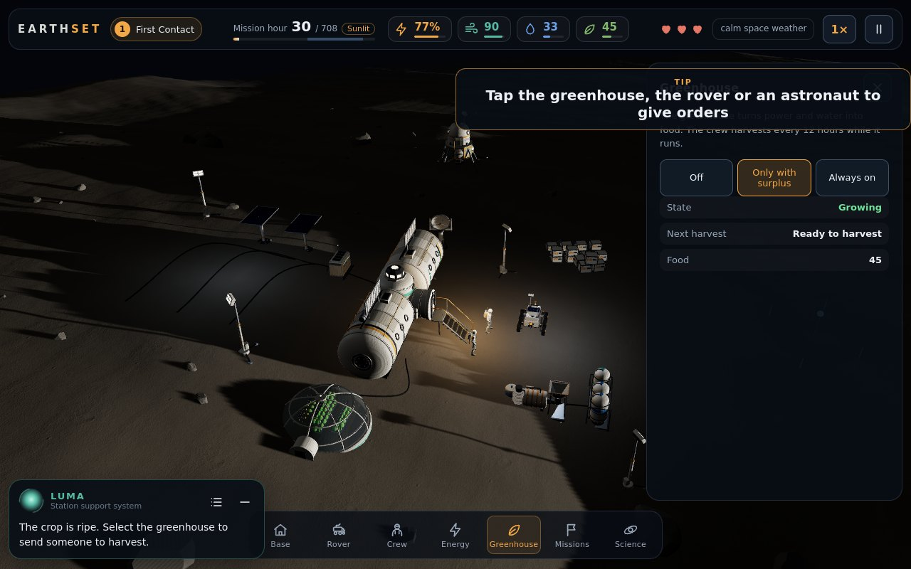 |
| **Rover:** ice trips, solar panel installation and the antenna. | **Greenhouse:** crop growth, wear and care. |
| 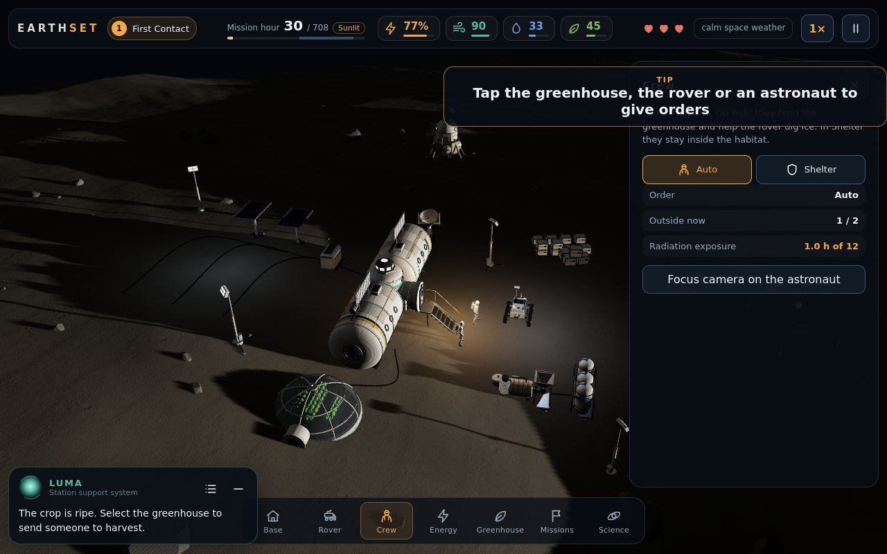 | 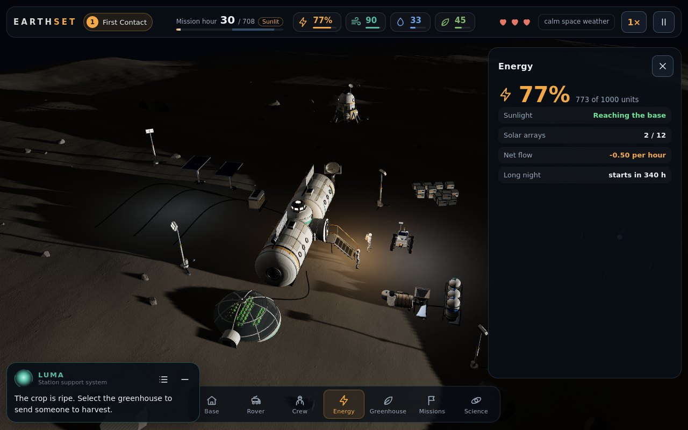 |
| **Crew:** the two astronauts, their tasks and radiation shelter. | **Energy:** solar panels, battery and power use. |
|  |  |
| **Missions:** the queue and the status of each task. | **Science:** the sky, the sun and the space weather, with their sources. |

**Alerts.** A solar storm shows up as a warning before the radiation starts, so the crew can shelter in time.

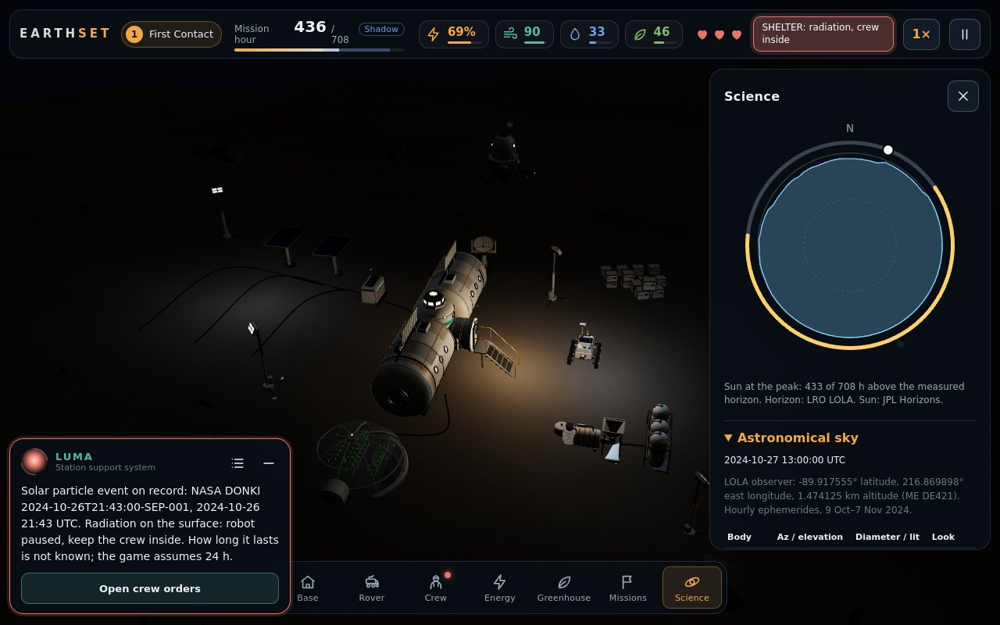

**Selection.** Tap the habitat, the rover, an astronaut or the antenna in the scene to open its panel.

| | |
|---|---|
|  |  |
| Habitat selected. | Rover selected. |
|  |  |
| Astronaut selected. | Antenna selected. |

**LUMA, the base guide.** LUMA explains what to do next and what is at risk. Its hints follow fixed rules, not a language model. A history panel keeps the recent messages.

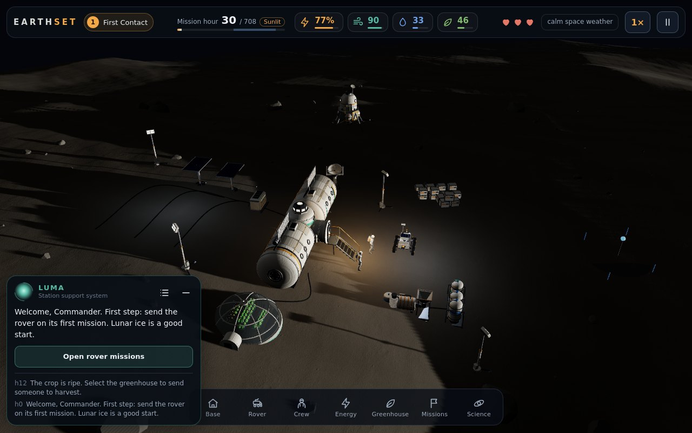

**Pause and end of match.** You can pause at any time. At the end, the summary shows the hours survived, lives left, ice loads, solar arrays and chapters completed.

| | |
|---|---|
| 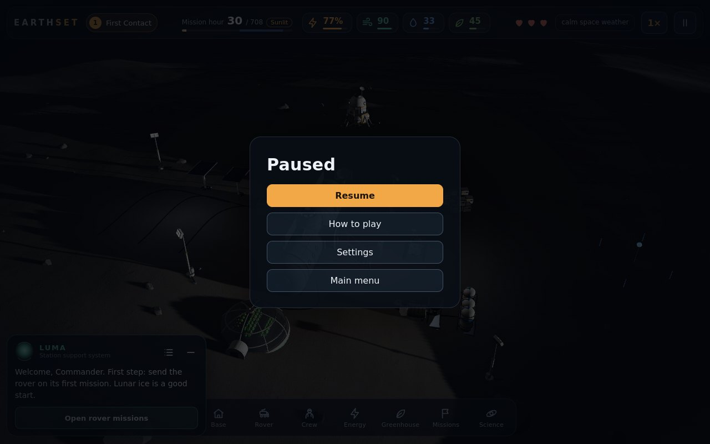 | 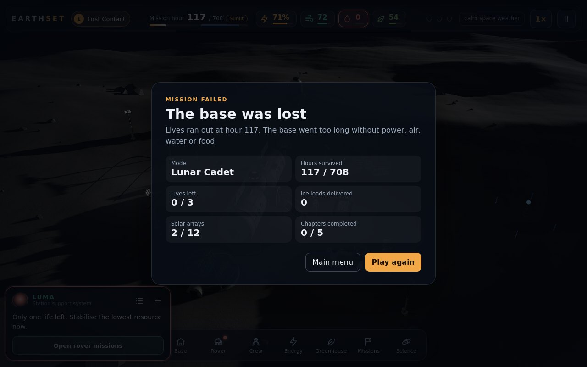 |
| Pause menu. | End of match: the summary of a finished mission. |

**Mobile.** The layout adapts to phones: panels can be collapsed, the team bar sits at the top, and the bottom bar stays in reach.

| | |
|---|---|
|  |  |
| The base on a phone. | The menu on a phone. |

**School mode.** The game has a simplified vocabulary for classroom use: the resources are called Energy, Air, Water and Food, and the panels, robot tasks, greenhouse and ice are labelled in plain language.

| | |
|---|---|
| 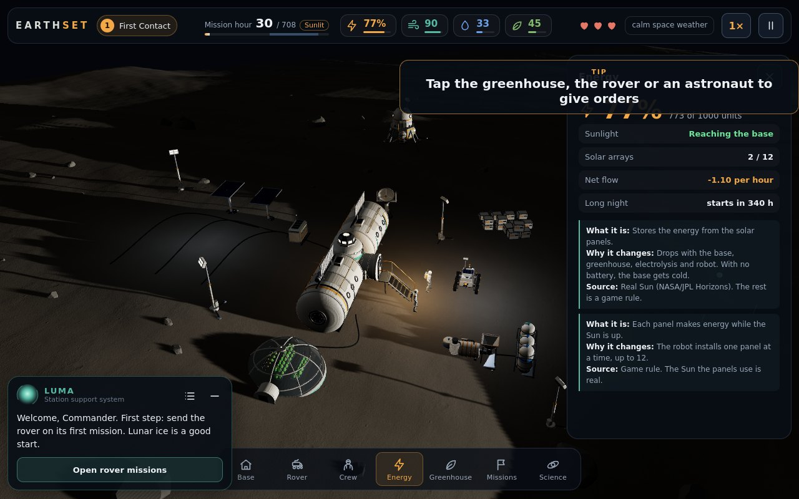 |  |
| School mode: the energy view. | School mode: the base view. |

> The screenshots come from the 15/11/2026 build. Some interface details changed after that date.

## 3. The base and its systems

- **Solar panels** produce power when the sun is above the local horizon. The battery stores the surplus and carries the night. Each panel adds output, and the base holds up to 12.
- **Greenhouse** grows food. A crop goes from seedling to developed to ready. Wear lowers its efficiency over time, and the care setting trades yield against wear. It needs power and water.
- **Life support** keeps air, water and food within range. A vital resource at zero costs hearts if it stays there for six hours.
- **Crew.** Two astronauts. They shelter during radiation and take tasks you assign.
- **Rover.** Runs the missions: ice trips to the ice deposit, solar panel installation and the antenna. Its trips follow a planned route with timings from the rover model, and it only works while the base battery has power. The queue holds up to four tasks.
- **Antenna.** Warns of storms ahead of time and must be installed for chapter 4.
- **Ice processor.** Turns delivered ice into water.

The base starts with two solar panels, a battery, a greenhouse and a site on the peak, which has the most sun exposure of the three candidate sites. Those starting values are a game balance choice, not a measurement; see [section 8](#8-illustrative-vs-measured).

## 4. Controls

- **Click or tap** a structure, an astronaut or the rover to open its panel.
- **Bottom bar:** switch between the views of the base, rover, crew, energy, greenhouse, missions and science.
- **Drag** to orbit the camera. **Arrow keys** move the camera; **`+` and `-`** zoom.
- **Earth button** (top bar): lights up when Earth is above the local horizon and moves the camera toward it. The position comes from the JPL Horizons ephemeris. From the pole, Earth stays near the horizon, so it is visible only for part of the lunar day.
- **Speed button:** 1×, 2× or 4×.
- **Pause** stops the clock; the view and panels stay available.

On a phone, use taps and drag. The bottom bar and the team bar stay on screen, and the panels can be collapsed with the button in their header.

## 5. Run it locally

Requirements: **Node.js 24** (the CI uses 24) and npm.

```bash
npm ci
npm run dev        # development server at http://localhost:5173
npm run typecheck  # TypeScript, strict mode
npm test           # unit and full-match tests (Vitest)
npm run build      # typecheck and production build into dist/
```

The data pipelines are in Python and run offline on the raw downloads. Their tests:

```bash
python3 -B -m unittest discover -s data-pipeline/tests
```

## 6. Deploy

The project is configured for **Vercel** with [`vercel.json`](vercel.json):

- framework: Vite
- install: `npm ci`
- build: `npm run build` (typecheck, then build)
- output: `dist/`

To deploy: import this repository in Vercel and keep the defaults above, with Node.js 24 in the project settings. Or run `npx vercel` in the project folder.

**Live deployment:** https://earthset-nasa-challenge.vercel.app (production, published with the Vercel CLI).

## 7. Science behind the game

| What | Source | How it is used |
|---|---|---|
| Sun, Earth, Mercury, Venus, Mars, Jupiter and Saturn: positions, apparent diameters and illumination | NASA/JPL Horizons, DE441 ephemeris | Hourly sky over the 708-hour window (2024-10-09 09:00 to 2024-11-07 21:00 UTC) |
| Lunar south pole terrain and the local horizon | LRO LOLA LDEM_80S_20M elevation model (NASA PDS) | Measured horizon at three candidate sites (peak, slope, rim) and the terrain mesh in the scene |
| Solar storms | NASA DONKI (geomagnetic storm and solar energetic particle records) | Historical space-weather scenario from October and November 2024; the particle events drive the radiation rule |
| Stars | Yale Bright Star Catalogue 5 (CDS V/50, NOIRLab mirror) | Star field in the sky |
| Ice on the Moon | Peer-reviewed and mission sources, listed in [`docs/data-sources.md`](docs/data-sources.md) (section 4b) | Basis of the ice mission |

The horizon matters. At the peak site, the measured horizon reaches 4.3° in some directions, so the sun rises and sets behind terrain for parts of the day. The slope and rim sites are more shadowed, with horizons up to 25° and 55°.

## 8. Illustrative vs. measured

The game separates three kinds of content, and marks each one in the code and on screen:

- **Measured data:** the ephemerides, horizons, space-weather records and star catalogue. Values and sources are in [`docs/data-sources.md`](docs/data-sources.md).
- **Game rules:** resource rates, robot speed, heart losses and the starting base are balance choices. They are documented in [`docs/regras-recursos.md`](docs/regras-recursos.md) and checked by full-match simulations.
- **Fiction:** the mission name, the crew story and the chapter narrative. They are never presented as NASA measurements.

## 9. Project structure

| Folder | Role |
|---|---|
| `src/engine/` | Game rules as pure TypeScript: no three.js, no DOM. Every rule is tested here |
| `src/astronomy/` | Sky calculations on top of the ephemeris tables (positions, visibility, Earth status) |
| `src/render/` | three.js scene, camera and terrain. It reads the state and never computes rules |
| `src/ui/` | HUD, panels, LUMA guide and the mobile layout. It sends validated actions to the engine |
| `src/data/` | Generated tables (sky, sun, terrain, space weather). Not edited by hand |
| `data-pipeline/` | Python scripts that fetch and convert the source data |
| `assets-src/` | Blender scripts that build the 3D models, and third-party asset sources |
| `public/` | Models, textures and fonts served by the app |
| `tests/` | Vitest suites for the engine, astronomy, rendering and interface |
| `docs/` | Data sources, game rules, third-party asset log, performance validation, references |

The engine is separate from the rendering on purpose: a rule change is made once, in the engine, and checked by tests before it reaches the screen.

## 10. Tests and verification

- **Engine:** unit tests for each rule, plus full-match tests that play complete days and check the win and loss conditions.
- **Astronomy:** tests for sky visibility and the Earth status.
- **Interface:** tests for the action messages and the language switch.
- **Data:** Python tests for the pipelines.
- **Continuous integration:** GitHub Actions runs typecheck, tests and build, and fails if the engine imports three.js or touches the DOM.

## 11. Known limitations

- The game has been checked with automated browser tests and by the author, not with a study of new players.
- Mobile layouts were tested in browser emulation at 412 × 915 and 320 × 568. They were not tested on a physical phone.
- The Earth is often dark or only a thin crescent when seen from the pole, because it sits near the horizon and its phase changes.
- The historical space-weather scenario covers October and November 2024. It is not a forecast for 2026.
- Frame rate on low-end devices has not been profiled on hardware.
- This project is not affiliated with or endorsed by NASA. No NASA logo, insignia or patch is used.

## 12. Credits and references

A full list of data sources, libraries, third-party assets and AI tools is in [`docs/references.md`](docs/references.md). The asset provenance log is [`docs/ART_ASSET_PIPELINE.md`](docs/ART_ASSET_PIPELINE.md).

## AI use

The project was built with AI coding agents (Claude Code and Codex). Their use, the models and the boundaries are described in [`AI_DISCLOSURE.md`](AI_DISCLOSURE.md). No generative AI runs inside the game.

## License

MIT. See [`LICENSE`](LICENSE).
