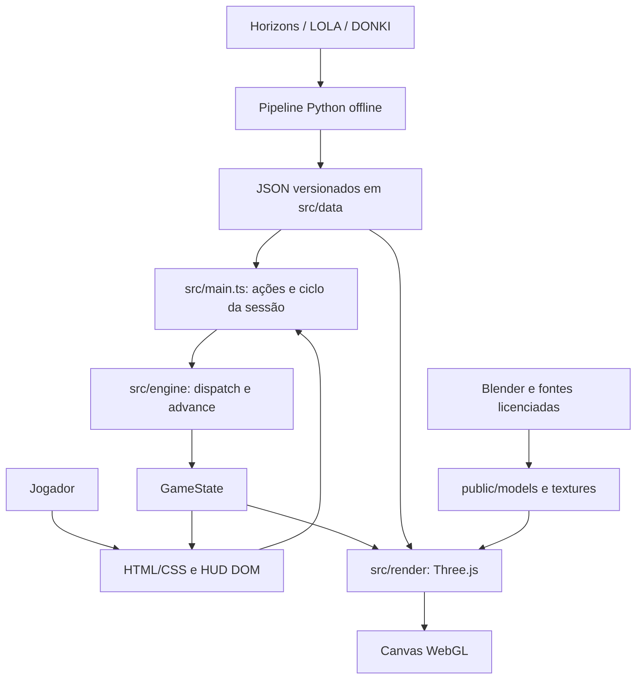
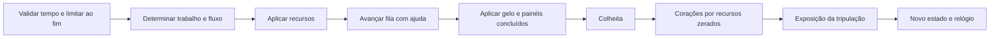

# Mapa do sistema Earthset

**Levantamento:** 14/11/2026, Codex. **Referência Git:** `57bd2d3`, mais alterações locais preexistentes, inclusive modelos GLB. Este documento descreve o sistema observado; não declara implementadas as propostas de [PLANO_CONSOLIDADO.md](PLANO_CONSOLIDADO.md). As regras de trabalho continuam em [AGENTS.md](../AGENTS.md).

## 1. Produto e finalidade

Earthset é um jogo educativo 3D de gestão de uma base no polo sul da Lua. O jogador equilibra energia, ar, água e comida, controla a estufa e agenda gelo, painéis e antena para o robô. A missão dura 708 horas de jogo; vitória exige pelo menos um dos três corações.

O resumo do [desafio oficial Build a Junior Astronaut Mission Trainer](https://www.spaceappschallenge.org/2026/challenges/junior-astronaut-mission-trainer/) foi localizado nesta auditoria no índice de busca do site: propõe um jogo/app para estudantes administrarem um posto lunar ou marciano, conciliando suporte à vida, radiação, energia e alimentos. Earthset está alinhado a esse núcleo. Não confundir isso com validação integral do enunciado/recursos ou dos guias: as aberturas diretas retornaram 502. A2 está parcialmente esclarecido; A5 permanece aberto.

O índice da [página oficial de 2026](https://www.spaceappschallenge.org/2026/) confirma o evento em 14–15/11 e fechamento de submissão em 15/11 às 23h59 locais. A meta interna do repo é 15/11 às 12h. Composição da equipe/Local Event, formatos exatos e condições finais de envio ainda precisam da conferência indicada em [event-rules.md](event-rules.md).

| Critério do projeto para julgamento | Implementação/evidência | Falta fechar |
| --- | --- | --- |
| Impact | Modo escola, explicações por recurso, decisões de sobrevivência | Orientação inicial e aprendizado após derrota/vitória |
| Creativity | Recursos, relevo, Sol e cenário de clima ligados à gestão | Tornar as consequências legíveis; não depende de mecânicas novas |
| Validity | Motor puro, testes, dados NASA e scripts reproduzíveis | Coerência geográfica, azimute e distinção entre dado e regra ilustrativa |
| Relevance | Base lunar, suporte à vida, energia, comida e radiação | Conferir todo o enunciado e registrar matriz de atendimento |
| Presentation | Jogo abre em inglês, cena 3D e HUD | Arte, mobile, demo, referências, página de submissão |

## 2. Arquitetura implantada

É uma aplicação estática executada no navegador. Não há backend próprio, banco, login, multiplayer ou processamento NASA em tempo real. Os scripts Python consultam fontes antes da execução; o navegador consome tabelas já incluídas no build. A preferência de idioma é persistida em localStorage; a partida fica apenas em memória.

O diagrama mostra dependências efetivas, incluindo leitura direta de dados pela cena. O motor recebe Sol/clima do chamador, não importa os JSON. Não existe ainda um objeto único com todos os dados de apresentação calculados para UI e cena.

### Organização por responsabilidade

| Caminho | Responsabilidade atual | Observação |
| --- | --- | --- |
| `index.html` | Estrutura, tokens CSS, HUD, título, pausa, créditos, fim e rodapé | CSS e marcação juntos; sem framework de UI |
| `src/main.ts` (199 linhas) | Configuração inicial, estado, dispatch, tempo, tela inicial/pausa, listeners, montagem | Já foi separado da cena; não é o antigo arquivo de ~480 linhas |
| `src/engine/game.ts` | Agrega GameState, valida ações, avança regras, decide resultado | Autoridade do jogo |
| `src/engine/clock.ts` | Relógio e limite de 708 h | Sem relógio de parede |
| `src/engine/resources.ts` | Fluxos e equipamentos automáticos | Equilíbrio ilustrativo |
| `src/engine/robot.ts` | Fila, recusas, progresso e tarefas concluídas | Não modela trajetórias físicas |
| `src/engine/crew.ts` | Abrigo, exposição e ajuda disponível | Representa tempos de trânsito, não posições 3D |
| `src/engine/harvest.ts` | Ciclo de colheita da estufa | Evento de alimento a cada 12 h ativa |
| `src/engine/sun.ts` | Seleção de amostra solar e comparação com horizonte | Amostra por hora, sem interpolação temporal |
| `src/engine/terrain.ts` | Interpolação circular do perfil de horizonte | Por azimute e site |
| `src/engine/space-weather.ts` | Amostra de clima, Kp→G, fator solar, aviso da antena | Penalidades são regras educativas |
| `src/data/*.json` e adaptadores `.ts` | Tabelas e tipos para importação | Casts de tipos; sem validação estrutural completa na entrada |
| `src/render/scene.ts` (684 linhas) | Renderer, câmera, terreno, céu, luz, base, rover, tripulação e animação | Maior concentração de responsabilidades |
| `src/render/assets.ts` | GLTFLoader, caches de promessas, cópias, substituição dos provisórios | Dois caches distintos: modelo e glTF com animações |
| `src/ui/hud.ts` (206 linhas) | Recursos, fila, alertas, idioma, modo escola, resultado | Atualização limitada a 100 ms pelo main |
| `src/ui/horizon-panel.ts` | SVG de horizonte e amostras solares | Curva fixa na montagem, marcador por hora |
| `src/i18n.ts` / `src/school.ts` | Traduções, preferência de idioma e textos educativos | Inglês padrão; PT-BR selecionável |
| `data-pipeline/` | Aquisição/redução de dados, testes Python e brutos | Não roda durante a partida |
| `assets-src/blender/` | Scripts de geração, conversão e preview | Blender 5.2.2 LTS disponível localmente |
| `assets-src/external/` | Fontes de terceiros e licenças | Não confundir candidatos com assets ativos |
| `public/` | GLBs e texturas distribuídos sem compilação | Versões locais modificadas são servidas pelo Vite |
| `tests/` | Motor, partidas completas, idiomas e modo escola | Vitest; não há suíte E2E versionada |
| `.github/` | CI e Dependabot | Sem workflow de publicação no repositório |
| `docs/` | Requisitos, regras, planos, decisões, fontes, arte e diário | Várias descrições de estado estão desatualizadas |

## 3. Estado e contrato do motor

`GameState` contém `clock`, `installation`, `vitals`, `robot`, `hearts`, `vitalZeroHours`, `crew` e `greenhouseHours`. Funções retornam novos estados; render/UI não devem alterá-los. Imutabilidade é um contrato TypeScript e de implementação, não congelamento recursivo em runtime.

| Comando | Validação/efeito |
| --- | --- |
| `SET_GREENHOUSE` | Modo `off`, `always` ou `surplus` |
| `ENQUEUE_TASK` | Tipo válido, fila até 4, painéis até 12 incluindo fila, uma antena |
| `CANCEL_TASK` | Índice inteiro existente; remove da fila |

`dispatch` retorna `{ok:true,state}` ou `{ok:false,reason}`. Os motivos são **códigos**, traduzidos pela interface; não são mais frases portuguesas como diz o AGENTS antigo. Após vitória/derrota, ações são recusadas.

Configuração da tela: explorador, morro (`peak`), 2 painéis, bateria de capacidade **1000**, estufa `surplus`. Começa com bateria 800, ar 80, água 50, comida 40 e três corações. Não há tela para escolher patente ou local, embora os tipos e fatores existam.

Regras já presentes:

- Produção solar depende de Sol/horizonte, número de painéis e fator de tempestade; consumo inclui base, aquecimento, robô, estufa e eletrólise.
- Estufa e eletrólise ligam por limiares. Economia abaixo de 40% desliga a estufa mesmo no modo `always`.
- Robô: gelo 6 h de trabalho, acelerado para 4 h de jogo com ajuda; painel 4 h; antena 8 h. Gelo repõe 12 de água.
- Radiação impede progresso do robô no motor. Tripulação exposta leva 1 h de jogo para abrigar-se; cada 12 horas-pessoa acumuladas de exposição tira um coração.
- Estufa: fluxo contínuo de comida se há água e bônus de 10 a cada 12 h de ativação. O bônus usa `isGreenhouseOn`, sem testar água separadamente: registrar como comportamento atual; rever só se essa for a intenção de produto.
- Recursos vitais zerados por 6 h consecutivas custam um coração. Vitória em 708 h, derrota ao zerar corações.

## 4. Processamento da partida

### Inicialização e quadros

1. Imports inicializam renderer/cena, referências DOM e idioma.
2. `createGame` cria o estado inicial; HUD e painel polar são montados.
3. GLBs carregam em segundo plano; geometria provisória aparece até o sucesso. Astronauta OGA tem fallback para `astronaut.glb`.
4. `requestAnimationFrame` mantém desenho e controles. O motor só avança se `started && !paused && outcome === playing`.
5. Tempo real do quadro é limitado a 0,1 s, multiplicado por **2 h de jogo/s real**. A duração nominal é 354 s (5 min 54 s), sem pausa e com cadência suficiente. Aba lenta/oculta não recupera todo o tempo perdido.
6. Sol/clima são amostrados pela hora do estado. HUD atualiza a cada 100 ms; ações atualizam imediatamente. O painel polar só muda o marcador quando muda a hora inteira.

### Ordem de `advance`

Equipamentos/fluxos são decididos pelo estado no início do passo; resultados de tarefas aplicam-se no fim. Isso é uma aproximação temporal documentada. Não há fila pública de eventos de domínio: `completed`, colheita e perda de coração são consumidos durante `advance`, sem histórico para a UI.

Experimento nesta auditoria: mesma política do teste de partida, decisões em horas inteiras, subpassos de 1 h, 0,2 h e 1/30 h. As três simulações venceram em 708 h com 2 corações; bateria final ~304,80 / 304,00 / 303,51. Evidência de estabilidade desse cenário, não prova de equivalência para qualquer ação/intervalo.

### Telas e persistência

- Título → New mission → jogo; Esc/botão abrem pausa; Resume retorna; Main menu reinicia o motor e volta ao título.
- Vitória/derrota usam overlay simples com reinício. Não há resumo de causas nem relatório de aprendizado.
- `started` e `paused` são flags fora do GameState. O render recebe tempo de parede e continua animando na pausa, no título e após o fim.
- Reinício do motor não possui um método explícito para reinicializar todo estado visual (posição do rover, mixers, transições). Isso merece teste e contrato próprio.
- Partida não é salva; recarregar perde progresso. Só idioma persiste. Não há telemetria de jogadores no código inspecionado.

## 5. Dados científicos e processamento offline

| Entrada | Processamento | Saída e uso |
| --- | --- | --- |
| JPL Horizons, Sol visto de ponto lunar | Consulta observer, azimute/elevação horária; parse do bloco SOE/EOE | `sun-south-pole.json`; decide iluminação e orienta luz |
| LOLA LDEM_80S_20M | Faixa por HTTP Range; 72 raios por site; correção de curvatura; escolha de três sites | `terrain-sites.json`; horizonte usado pelo motor |
| Mesmo DEM | Interpolação do recorte de 400 m | `terrain-mesh.json`; 160×160 vértices, exagero visual 2× |
| DONKI GST/SEP | Kp máximo por hora; janela retrospectiva de 3 h; SEP com duração ilustrativa de 24 h | `space-weather.json`; tempestade, radiação e aviso |

Os três scripts usam biblioteca padrão Python e suportam processamento de brutos locais. `NASA_API_KEY` é lida apenas pelo script DONKI no ambiente. Os brutos pequenos estão no projeto; o binário LOLA grande é ignorado pelo Git. Regenerar dados não é necessário para build ou para abrir o jogo.

**Estado numérico recalculado dos JSON atuais:**

| Item | Valor |
| --- | --- |
| Janela solar e DONKI | 2024-10-09 09:00 UTC → 2024-11-07 21:00 UTC |
| Passo e quantidade | 1 h; 709 amostras cobrindo 708 intervalos |
| Elevação solar | 0,1611° a 1,0361°; todas as amostras acima do horizonte plano |
| Morro | 412 amostras com Sol; **411 intervalos de 1 h** iluminados durante as 708 h, pela amostragem atual |
| Encosta / borda | 179 / 0 amostras com Sol |
| Tempestade | Primeiro Kp ≥ 5 na hora 30; máximo Kp 8,67 |
| Radiação | 76 amostras marcadas, incluindo o início |
| Morro no DEM | x = −1500 m, y = −2000 m; 2,5 km do polo |

As amostras solares e de clima foram reprocessadas em memória dos brutos e coincidiram com os JSON atuais. Não foram sobrescritas. A malha 160×160 não cria resolução científica de 2,5 m: é reamostragem de dados de 20 m.

**Lacuna de validade:** o observador Horizons é lat −89,5°, lon 0°, aproximadamente 15,2 km do polo usando o raio lunar empregado pelo pipeline. O morro LOLA fica a 2,5 km do polo em outra direção. Os metadados, portanto, não descrevem um mesmo ponto geográfico. A orientação de norte/leste no plano polar também precisa ser comparada com o norte local do observador. Os testes atuais verificam fórmulas e convenções assumidas, não essa associação externa. Não corrigir tabelas silenciosamente: isso pode mudar períodos de luz e equilíbrio.

**Distinção necessária:** efemérides, DEM e registros de eventos são dados de origem científica. Perda de 10% de geração por nível G, duração SEP de 24 h, tarefas, bônus, recursos e corações são regras de jogo. Não apresentar a penalidade derivada de Kp como uma medição de produção de painel lunar.

## 6. Apresentação 3D e assets

- Three.js 0.186.1, PerspectiveCamera, OrbitControls, WebGL, ACES e luz direcional pelo Sol. Luz ambiente para legibilidade e sombras com mapa 2048.
- Cena mistura geometrias provisórias e GLBs carregados. `attachModel` oculta os provisórios; materiais clonados/específicos precisam continuar vinculados ao objeto ativo.
- Astronauta ativo: OGA (CC0), clipes `default` e `run`, clones via SkeletonUtils e mixer individual. A caminhada desacelera a corrida. `astronaut_v2.glb` é candidato inativo.
- Trajeto do rover é visual: 0–35% ida, 35–65% trabalho, 65–100% volta. O motor não conhece metros nem colisões.
- Terreno provém de LOLA; textura Poly Haven e modelos são arte. Marcador de gelo e posições de tarefa são ilustrativos.
- Não há gestão explícita de ciclo de vida/dispose da cena, teste de perda do contexto WebGL ou modo gráfico reduzido. “Modo escola” atualmente simplifica texto, não reduz custo de GPU.

A auditoria visual local em `.scratch-agent/visual-audit-2026-11-14/diagnostico.md` contém imagens desktop/mobile e causas: montagem/pivôs do rover, sombra sobre a própria superfície do habitat, astronauta pouco legível e base cortada no mobile. Essa pasta é rascunho local, não artefato garantido num clone do repositório. As cúpulas do habitat atual estão posicionadas corretamente.

## 7. Divergências de comportamento identificadas no código

| Evidência | Consequência | Proposta |
| --- | --- | --- |
| `placeRover` usa `isWorking` sem radiação; `advance` inclui `!weather.radiation` | Cena pode mostrar rodas/atividade quando a tarefa está parada pelo clima | Derivar o estado operacional uma vez e fornecê-lo a UI/cena |
| `updateCrew` manda helper ao abrigo e depois executa outro `walkCrew` para trabalho/casa no mesmo quadro | O segundo destino interfere na reação à radiação | Prioridade exclusiva e apresentação derivada de `state.crew` |
| Render não lê `state.crew.transitLeft` para determinar abrigo | Aparência de exposição não acompanha necessariamente o estado científico | Mostrar trânsito/abrigado segundo o motor; suavização só visual |
| `panelMat` e `robotBodyMat` ainda são os materiais provisórios após `attachModel` | Mudanças de brilho podem afetar objetos escondidos | Referências explícitas aos materiais ativos do GLB |
| Fila usa comparação por referência, mas o motor cria nova fila ao progredir | Reconstrói botões frequentemente; risco de perda de foco ao cancelar | Preservar nós DOM; atualizar texto e estrutura separadamente |
| Render recebe tempo de parede mesmo pausado | Animações continuam com simulação congelada | Contrato explícito para tempo de apresentação/pausa |
| Gelo indisponibiliza ajuda na radiação, que também para o robô | Caso “6 h sem ajuda” não surge normalmente no fluxo atual | Decisão de produto D-06; não alterar a regra durante refatoração |

Essas conclusões vêm de leitura do código; não equivalem à reprodução visual exaustiva de cada transição. Somente os achados da auditoria visual têm as capturas já mencionadas.

## 8. Qualidade, build e operação

Stack: Node 24/npm, TypeScript strict, Vite, Three.js, Vitest e Python. `npm run build` produz `dist/`; modelos e texturas de `public/` acompanham o build. Não há configuração Vite própria ou host de produção definido no código. Hospedagem em subdiretório exige validar `base` e todos os caminhos antes de publicar.

CI em push de main/PR: npm ci, tipos, Vitest, unittest Python, build, auditoria de produção e artefato `dist` por 14 dias. Outro job verifica fronteira por regex. Dependabot cobre npm e Actions. A regex cobre casos comuns, não é um verificador completo de dependências/transitividade ou todas as APIs DOM.

Verificação disponível:

- Na auditoria visual imediatamente anterior desta sessão: typecheck, **84 testes Vitest em 13 arquivos** e build passaram; nenhum código-fonte foi alterado entre os levantamentos. Build de 840,68 kB para o chunk principal, gzip 204,83 kB, com aviso de tamanho.
- Nesta etapa: **22 testes Python passaram**; comparações dos brutos solar/DONKI com JSON passaram; três simulações com passos distintos venceram com 2 corações.
- CI remoto do commit `57bd2d3`: SUCCESS. Não comprova os GLBs locais modificados nem mudanças de documentação não commitadas.
- Não há testes E2E versionados, regressão de GLB, benchmark em hardware real ou comprovação completa de acessibilidade.
- O browser anterior mostrou aviso de PCFSoftShadowMap removido, favicon 404 e avisos de captura ReadPixels. Modelos/texturas carregaram HTTP 200.

## 9. Git e GitHub

Consulta remota de 14/11/2026: [dev-christianmendes/earthset-nasa-challenge](https://github.com/dev-christianmendes/earthset-nasa-challenge), público, branch padrão main, usuário autenticado dev-christianmendes com **ADMIN**. Local, tracking e remoto em `57bd2d3e028fe349e50148ea250372225722b0d2`; zero commits de divergência. Zero issues abertas e zero PRs abertas no instante da consulta.

A árvore local tem modificações anteriores de documentação, declarações, scripts e seis modelos, além de previews e astronauta v2 não rastreados. Não confundir sincronia dos commits com árvore limpa. Os relatos de “2/7 commits não enviados” e hashes antigos nos planos não descrevem o remoto atual.

Há capacidade técnica para commits, branches, PRs, issues e ajustes do repositório; só leitura foi executada nesta etapa. Para o trabalho acordado, seguir Conventional Commits em português e lotes revisáveis. Não usar trailer de Claude em trabalho do Codex. Publicação da demo/submissão ao evento e reescrita de histórico são ações separadas; nenhuma foi executada ou presumida neste levantamento.

## 10. Organização dos documentos e lacunas de entrega

| Documento | Papel recomendado |
| --- | --- |
| AGENTS | Regras de colaboração; os parágrafos de estado precisam ser enxugados/atualizados |
| Este mapa | Estado observado, limites e evidências |
| PLANO_CONSOLIDADO | Proposta de execução única para revisão |
| arquitetura / backlog / PLANO_PARA_AGENTE | Requisitos e histórico a reconciliar, sem apagar decisões passadas |
| DECISOES | Decisões do autor e alterações de escopo; D-02 foi superada parcialmente por D-05–D-08 |
| data-sources / regras-recursos | Proveniência e regras, respectivamente; números precisam refletir os dados/código atuais |
| ART_ASSET_PIPELINE / VISUAL_DIRECTION | Fontes, licenças e contrato de arte |
| execution-log | Histórico de comandos, resultados, falhas e evidências |
| event-rules / AI_DISCLOSURE | Entrega, termos e declaração; permanecem pendências |

Contradições concretas: bateria 1200 vs 1000; radiação 6 vs 12 horas-pessoa; 379/448 h de Sol vs 412 amostras; tempestade na hora 63 vs 30; 82 h de radiação vs 76 amostras; “LOLA adiado” apesar de integrado; “sem GLB/terceiros” apesar de carregados; “pausa não existe” apesar de implementada; `main.ts` descrito como dono da cena; cúpulas marcadas defeituosas apesar da correção local.

Arquivos citados mas ausentes: `docs/references.md`, `docs/demo-script.md`, `docs/projeto-earthset.pdf`. Não existe ainda pacote de entrega em inglês com referências completas, demo e declaração final. Preparação da missão, diário, linguagem por patente, acompanhamento do rover, aceno e animação de colheita também não estão concluídos; nem todos são necessários para fechar a versão do evento.

**Conclusão:** preservar o núcleo funcional. O fechamento deve priorizar validade dos dados, consistência entre motor e apresentação, experiência utilizável, evidência de qualidade e entrega. A arquitetura proposta e a ordem executável estão em [PLANO_CONSOLIDADO.md](PLANO_CONSOLIDADO.md).
