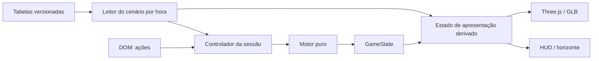

# Plano consolidado para fechar o Earthset

**Proposta para revisão, 14/11/2026.** Base: [mapa do sistema observado](MAPA_SISTEMA.md), [arquitetura original](arquitetura.md), [backlog](backlog.md), [decisões do autor](DECISOES.md) e auditoria visual local em `.scratch-agent/visual-audit-2026-11-14/diagnostico.md`. Este plano não registra tarefas como concluídas e não autoriza publicar ou submeter a demo. A meta interna é 15/11 às 12h locais; o prazo do evento é 23h59.

## Direção

Conservar a aplicação estática Vite/TypeScript/Three.js e o motor puro já funcional. Fechar um caminho demonstrável de **decisão → consequência → explicação**, com dados e limites científicos honestos. A arte e a arquitetura devem servir essa demonstração. Para a versão do evento, favorecer correções isoladas, rastreáveis e testáveis; evitar novos subsistemas amplos.

O [desafio oficial](https://www.spaceappschallenge.org/2026/challenges/junior-astronaut-mission-trainer/) pede que estudantes administrem um posto lunar ou marciano e percebam os compromissos entre suporte à vida, radiação, energia e alimentos. A partida existente já cobre esses verbos. A lacuna principal é torná-los compreensíveis e defendê-los na demo. O enunciado completo e o guia de envio ainda precisam de leitura efetiva.

## Arquitetura alvo mínima

**Contratos propostos:**

1. **Motor:** `GameState`, `dispatch`, `advance`, `outcomeOf`. Somente ele muda recursos, fila, corações e relógio. Manter assinaturas atuais durante as primeiras correções.
2. **Cenário:** um leitor puro recebe hora e site, devolve Sol, `sunlit`, Kp/radiação e aviso. A associação espacial/temporal deve ser auditada antes de qualquer regeneração de tabela.
3. **Estado de apresentação:** um valor derivado do `GameState` e do cenário informa se robô trabalha, se tripulação está a caminho/abrigada, se estufa está operacional e o que o HUD deve anunciar. UI/cena recebem a mesma interpretação; não são outra fonte de regras.
4. **Controlador da sessão:** ações da interface, relógio real, iniciar/pausar/reiniciar e atualização dos adaptadores. `GameState` segue separado das flags de tela, mas o ciclo de vida fica explícito.
5. **Render:** cena e assets são consumidores. Posições e efeitos representam a missão; não determinam conclusão de tarefa. A extração de `scene.ts` em módulos só ocorre ao mexer nas partes correspondentes.
6. **Dados:** Python offline gera JSON sob `src/data`; validar tamanho, cronologia, coordenadas e hashes contra os brutos. O build nunca consulta API NASA.

Esse desenho admite implementar `scene-snapshot.ts`/`session.ts` pequenos quando os defeitos concretos forem corrigidos. Não exige event bus, React, servidor, persistência da partida ou reescrita do motor para o evento.

## Ordem executável

| Prioridade | Entrega e escopo | Critério de aceite | Commit semântico sugerido |
| --- | --- | --- | --- |
| **P0.1** | Matriz do desafio e dos guias de envio; confirmar A2/A3/A5 e formato oficial; corrigir afirmações de status da documentação | Cada requisito oficial tem evidência, lacuna ou decisão pendente. A2 só fecha após leitura integral. Equipe/evento confirmados pelo autor | `docs(evento): confere desafio e requisitos de envio` |
| **P0.2** | Revisão científica do cenário: posição do Sol versus site LOLA, convenção azimutal, janela DONKI; distinguir dado de efeito ilustrativo | Documento com coordenadas, método e comparação independente. Se mudar JSON/regra, teste de partida e interface revisados antes de substituir dados | `docs(dados): audita coerência do cenário lunar` e, se cabível, `fix(dados): alinha posição e horizonte do cenário` |
| **P0.3** | Contrato de apresentação e correções visuais de estado: radiação realmente para o rover; tripulação abriga sem segundo destino; GLB ativo recebe cor/brilho; reinício e pausa consistentes | Estado do motor e cena coincidem em trabalho, radiação, instalações e recomeço. Teste de domínio apenas onde muda regra; Playwright para o resto | `fix(render): alinha rover e tripulação ao estado da partida` |
| **P0.4** | Usabilidade mínima: enquadramento mobile, foco da fila, orientação de início, estados de perda/vitória com causa e aprendizado, revisão EN/PT | Fluxo completo em 1280×800 e 390×844; controles acessíveis por teclado; mensagens entendidas sem abrir código | `fix(tela): melhora leitura da missão no celular` e `feat(tela): explica resultado da missão` |
| **P0.5** | Arte crítica: pivôs/montagem do rover, sombra do habitat, astronauta legível; integrar GLB sem apagar alterações locais | Critérios da auditoria visual passam; nomes/pivôs/clipes validados; screenshots comparáveis. Licenças e atribuições registradas | `fix(assets): corrige montagem e pivôs do rover`; `fix(render): ajusta sombras e enquadramento` |
| **P0.6** | Pacote de entrega em inglês: referência de todos os dados/bibliotecas/ativos, declaração de SI completa, demo de 30 s **ou** até 7 slides, prova de execução | Materiais dentro do limite oficial; créditos verificáveis; link/teste da demo; roteiro mostra o desafio e o resultado | `docs(envio): prepara referências e roteiro da demonstração` |

**Sequência recomendada sob prazo curto:** começar P0.1 e P0.2 em paralelo apenas como leituras; depois P0.3 e P0.4; aplicar os consertos de maior impacto de P0.5; reservar tempo protegido para P0.6. O corte mínimo para a banca é uma partida compreensível, dados bem qualificados e material de envio completo. Arte adicional não deve consumir a janela de submissão.

### Trabalho que pode seguir depois do núcleo

| Origem | Estado e proposta |
| --- | --- |
| T6 / F5 | Revisão de texto, rótulos e acessibilidade; entra em P0.4 |
| T7 | Pausa/Esc/retorno ao menu: já existe; falta teste de fluxo e reset; entra em P0.3/P0.4 |
| T9 | Medir FPS, carregamento e memória em máquina real; escolher otimização pelo gargalo; começar após correções P0.3 |
| T11 / D-08 | Aceno e trabalho visual na estufa; úteis para demo se houver tempo, sem alterar regra |
| T13 | Colheita já está no motor; animação ainda falta. O bônus de comida deve ser explicado |
| T15–T18 | Arte completa e revisão humana; fazer após corrigir montagem, sombras e câmera e antes do envio apenas se couber |
| I2 / R-PAT | Patente altera consumo, mas não há seleção nem linguagem própria. Se for incluída na demo, implementar preparação e copy juntas; caso contrário documentar como extensão |
| I3 / R-LOG | Diário não existe. O motor não emite eventos públicos; pode ser derivado por diferenças entre estados para eventos básicos, sem mudar recursos. Prioridade após P0 |
| T8 | Seguir rover é opcional; ajuda na demo se a câmera base já estiver correta |

### Fora do caminho crítico

Salvar/carregar partida, multiplayer, backend, painel de administração, física de rover, novas fontes de dados, mudança de engine, LOD complexo e redesign integral. Considerar só com problema medido ou novo requisito oficial. O projeto é estático e a exigência principal é demonstrar as decisões da base.

## Decisões que exigem revisão explícita

| Ponto | Alternativas já concretas | Recomendação técnica |
| --- | --- | --- |
| **Posição científica** | Recalcular Sol para o site LOLA; escolher site próximo ao observador; ou apresentar Sol regional aproximado | Auditar azimute/coordenadas primeiro. A decisão final pode mexer no equilíbrio; registrar nova simulação e origem |
| **Modelos locais não commitados** | Promover após correções visuais ou manter versão anterior | Avaliar os GLBs servidos localmente, sem `git checkout` destrutivo. O bug antigo das cúpulas não se reproduz |
| **Astronauta final** | Refinar OGA CC0; corrigir v2 próprio; outro asset com licença compatível | Comparar aparência/animações em runtime e licenças. Não trocar só por contagem de polígonos |
| **Ajuda ao gelo D-06** | Manter simplificação de 4 h sempre que trabalha; criar condição real para 6 h | Para o evento, explicar a simplificação; alterar a regra só com revisão do equilíbrio |
| **Equipe e submissão** | Local Event solo ou outra composição; destino final de hospedagem | Confirmar no site do evento. Preparar conteúdo antes de qualquer envio |

## Critérios para uma etapa estar pronta

1. Resultado visível e comportamento descritos em uma frase verificável; ligação ao item do backlog/decisão.
2. Testes adequados ao risco: `npm run typecheck`, `npm run test`, `python3 -m unittest discover -s data-pipeline/tests` quando dados mudarem, `npm run build`; testar partida completa se mudar Sol, horizonte, clima, recursos ou tempos.
3. Se a tela mudar, capturas desktop/celular vistas de fato; para bug visual temporal, capturar antes/depois no mesmo estado e câmera. Console e HTTP sem erros relevantes. FPS em hardware real para alegação de desempenho.
4. `docs/data-sources.md` para ciência, `docs/regras-recursos.md` para números de jogo, `docs/ART_ASSET_PIPELINE.md` para ativos externos. Ilustrativo marcado na tela e na explicação.
5. `docs/execution-log.md` registra comandos, resultados, falhas e limites. Backlog só recebe `[x]` quando o aceite passar.
6. Commit por unidade revisável, mensagem Conventional Commits em português. Conferir `git diff --cached` antes do commit para não incorporar mudanças antigas de outro assunto. Verificar CI após push autorizado; não incluir trailer de outra ferramenta de IA.

## GitHub e colaboração

A conta `dev-christianmendes` foi validada com permissão ADMIN; main local/remota estão em `57bd2d3`, CI bem-sucedido. Há alterações locais preexistentes em documentação, Blender e GLBs. Não criar um commit único com tudo: separar a autoria e o propósito de cada mudança, revisar os diffs e só então fazer commits/push conforme o fluxo aprovado pelo autor. Nenhuma ação de escrita no GitHub integra este plano; ele é uma proposta concreta para análise.

Quando escolher a hospedagem da demo, validar caminhos absolutos/`BASE_URL`, carregamento dos GLBs e fluxo completo no endereço publicado. A submissão ao evento e o site hospedado são entregas distintas.
